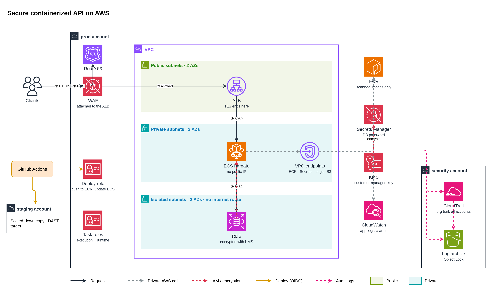

# DevSecOps home test

A small Node.js API, a security-gated GitHub Actions pipeline around it, and Terraform for running it on AWS (ECS Fargate behind ALB + WAF, RDS, no NAT).

| Task | Where |
|---|---|
| 1. AWS architecture | `architecture/architecture-diagram.png`, `architecture/decisions.md` |
| 2. CI/CD security pipeline | `.github/workflows/`, `security/pipeline-gates.md`, `evidence/task2/` |
| 3. Terraform and IAM | `terraform/`, `security/terraform-scenarios.md`, `evidence/task3/` |
| 4. Container security | `app/Dockerfile`, `security/container-security.md`, `security/vulnerability-policy.md`, `evidence/task4/` |
| 5. Troubleshooting and incident response | `security/incident-response.md` |
| 6. DAST and OWASP Top 10 | `security/dast.md` |

Evidence index: `evidence/scan-results.md`.

## Architecture overview



```
Internet
   ↓ HTTPS 443
ALB + AWS WAF (managed rules, rate limit)             public subnets
   ↓ 8080, from the ALB security group only
ECS Fargate tasks, no public IP                       private subnets
   ↓ 5432, from the app security group only, TLS forced
RDS Postgres, encrypted with a customer-managed key   isolated subnets

Tasks reach AWS only through VPC endpoints (ECR, Secrets Manager, CloudWatch Logs, S3). No NAT, no internet egress.
```

- **Compute: ECS Fargate.** AWS patches the host, each task is its own micro-VM, and there's no cluster control plane to secure.
- **Secrets:** RDS generates the DB password in Secrets Manager. The task definition holds only the ARN, and the ECS agent injects the value at start using the task execution role.
- **IAM:** three single-purpose roles. The deploy role is assumed by GitHub Actions through OIDC, so no access key exists anywhere.
- **Accounts:** production, staging (the DAST target) and a security account holding the org CloudTrail and log archive under Object Lock.

Every choice and what was rejected: `architecture/decisions.md`.

## Prerequisites

| Tool | Version used |
|---|---|
| Docker | 29 |
| Node.js | 22 |
| Terraform | 1.10 or newer (1.15 used) |
| Trivy | 0.76.1 |
| Checkov | 3.3.30 |
| Gitleaks | 8.30.1 |

The pipeline itself needs nothing installed: every scanner runs from a pinned container image or a checksum-verified binary.

## Running it

```bash
cd app
npm ci && npm test
docker build -t orders-api:local .
docker run --rm -p 8080:8080 -e DB_PASSWORD=local-only orders-api:local
curl localhost:8080/health
```

The app refuses to start without `DB_PASSWORD`.

## Validate Terraform and scan the container

```bash
cd terraform
terraform fmt -check -recursive
terraform init -backend=false
terraform validate
cd ..

checkov --config-file .checkov.yaml -d . --framework terraform dockerfile

trivy fs --scanners vuln --severity HIGH,CRITICAL app
trivy image --ignorefile .trivyignore.yaml --severity CRITICAL --exit-code 1 orders-api:local
trivy image --ignorefile .trivyignore.yaml --severity HIGH --ignore-unfixed --exit-code 1 orders-api:local

gitleaks git . --redact
```

Applying Terraform for real: copy `terraform/backend.hcl.example` to `backend.hcl`, fill in the state bucket and KMS key, then `terraform init -backend-config=backend.hcl` and `terraform plan -var environment=staging -var certificate_arn=... -var alb_access_logs_bucket=...`.

## CI/CD workflow and security gates

```
pull request or push to main
        ↓
validate · sast (Semgrep) · sca (Trivy fs) · secrets (Gitleaks) · iac (Checkov)
        ↓ all pass
build → image.tar
        ↓
container-scan (Trivy) · dast (ZAP baseline)
        ↓ push to main only
publish to GHCR (the exact image that was scanned)
        ↓
deploy-staging → deploy-production (required reviewer, main only)
```

| Gate | Blocks on |
|---|---|
| Tests, Terraform fmt/validate | Any failure |
| Semgrep | Any finding |
| Trivy fs (dependencies) | High or Critical |
| Gitleaks (full history) | Any secret |
| Checkov (+ custom policy `CKV2_ORDERS_1`) | Any failed check without an inline reason |
| Trivy image | Any Critical, or High with a fix available |
| ZAP baseline | Any WARN or FAIL |
| Production deploy | No approval from the required reviewer |

Lower severities follow `security/vulnerability-policy.md`. A nightly workflow rescans `main` and opens one GitHub issue per High or Critical finding. False positives and accepted risks are handled in reviewed files with a reason and an expiry: details in `security/pipeline-gates.md`.

Pipeline hardening: workflow token is `contents: read` by default and each job asks only for what it needs; deploy jobs use OIDC (`id-token: write`) instead of stored keys; every action is pinned to a commit SHA; Dependabot bumps actions, npm packages and base image digests (minor and patch only).

## Security decisions and assumptions

- **Semgrep instead of SonarQube** for SAST. Same gate logic, no server to host for a take-home.
- **Distroless base image**, chosen after scanning 4 candidates. 410 MB → 53 MB, Critical/High 30/626 → 1/6.
- **The remaining 1 Critical + 6 High are accepted until 2026-11-07.** They are all in Debian's `libssl3`, which Node never loads (it statically links its own OpenSSL). Evidence: `evidence/task4/libssl-reachability.txt`.
- **No NAT gateway.** VPC endpoints cost more (~$60/month) but tasks can't reach the internet at all. If the app ever needs third-party APIs: NAT plus AWS Network Firewall with a domain allowlist.
- **Secrets injected at container start**, not fetched by the app. A rotated secret takes effect on the next deploy.
- **Multi-AZ RDS in production only**, single-AZ in staging to halve cost.
- **GHCR is the pipeline's registry; ECR is the runtime registry.** The deploy job copies the scanned image by digest into ECR, which Fargate reaches through a VPC endpoint.
- Assumed: one region (`ap-southeast-3`), an ACM certificate and a log archive bucket already exist, and the app is the only service.

## Known limitations and remaining risks

- **Terraform is validated and scanned, not applied.** No AWS account is wired to the GitHub Environments, so the deploy jobs run as a simulation: they skip the AWS steps and log the image they would deploy. Setting `AWS_DEPLOY_ROLE_ARN` and `ECR_REPOSITORY` on each Environment turns them on with no code change.
- **DAST is a passive baseline against the CI container.** The nightly active scan against staging is designed (`security/dast.md`) but not built, because staging isn't deployed.
- **The app has no authentication**, so authenticated scanning and access control checks are design only.
- **Production self-review is allowed** because this repo has one maintainer. In a team, "Prevent self-review" stays on.
- **Tool images are pinned by version tag, not digest.** Actions are SHA-pinned and Gitleaks is checksum-verified; the scanner images are the remaining supply-chain gap.
- **Trivy can't see the OpenSSL compiled into the Node binary.** That copy is covered by tracking Node.js security releases.
- **The libssl3 exception expires 2026-11-07.** If distroless hasn't rebuilt by then, the gate goes red and the decision has to be made again, which is the point.
- The security account (org CloudTrail, log archive, SCPs) is documented, not built.

## Evidence of tests and scans

| What | File |
|---|---|
| Green pipeline run, production waiting for approval, then approved | `evidence/task2/01` to `04` |
| PR with a vulnerable dependency and a hardcoded key, blocked by SCA and Gitleaks | `evidence/task2/05` to `07` |
| Terraform validate | `evidence/task3/terraform-validate.txt` |
| Checkov on the real Terraform: 183 passed, 0 failed, 1 skipped with a reason | `evidence/task3/checkov-terraform.txt` |
| Checkov on a deliberately public database: 10 failed, including the custom policy | `evidence/task3/checkov-scenario-b-public-db.txt` |
| Trivy before/after hardening | `evidence/task4/scan-summary.md`, `trivy-before-critical.txt`, `trivy-after.txt` |
| Runtime checks: non-root, no shell, read-only code, no secret in the image | `evidence/task4/runtime-checks.txt` |
| libssl3 reachability | `evidence/task4/libssl-reachability.txt` |
| Every CI scan report | Workflow artifacts on each run in the Actions tab |
